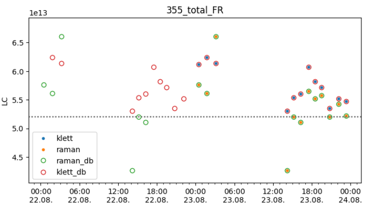

*********************
Calibration Constants
*********************

Polarization Calibration
=========================

The delta-90 polarization calibration for the detected time periods is done with :py:meth:`~ppcpy.interface.picassoProc.PicassoProc.polarizationCaliD90`.
Resulting etas are stored in ``data_cube.pol_cali`` for all the time intervals and ``data_cube.etaused`` for the one with the lowest standard deviation.

.. code-block:: python

    >>> data_cube.polarizationCaliD90()
    >>> data_cube.pol_cali
    {'D90': 
      {'355_FR': [
        {'eta': 10.602253607032777,
          'eta_std': 0.36947564349830514,
          'time_start': 1755916590,
          'time_end': 1755916800,
          'status': 1},
        {'eta': 10.45194101666947,
          'eta_std': 0.27254858255926373,
          'time_start': 1755968190,
          'time_end': 1755968400,
          'status': 1}, 
    ... ]
    >>> data_cube.etaused
    {'355_FR': {'eta': np.float64(17.676435110135806),
                'eta_std': np.float64(0.32833545538381936),
                 'method': np.str_('D90')},
     '532_FR': {'eta': np.float64(28.24637095518135),
                'eta_std': np.float64(0.12395108508599821),
                'method': np.str_('D90')},
     ... }

A method for polarization calibration at the reference height is also implemented, but not extensively tested or used operationally: :py:meth:`~ppcpy.interface.picassoProc.PicassoProc.polarizationCaliMol`

The calibration of the DFOV is done by comparing with the inner field of view in the ``cldFreGrps`` by 
calling :py:meth:`~ppcpy.interface.picassoProc.PicassoProc.polarizationCaliOuterFOV` 
after the first :py:meth:`~ppcpy.interface.picassoProc.PicassoProc.aggregate_profiles`.
Optionally a diagnostics plot can be generated and additional variables can be stored to a separate database:

.. code-block:: python

    debug = data_cube.polarizationCaliOuterFOV(store_debug=True, collect_vars_plot=True)
    import ppcpy.visualization.aid_debugging as ad
    ad.plot_cals(data_cube.pol_cali, 'eta', data_cube.etaused)
    ad.plot_outerFOV_debug(debug, np.array(data_cube.retrievals_highres['height'])/1000)

Lidar (absolute) Calibration
==============================

After retrieval of the optical profiles, the Lidar calibration constants can be calculated with :py:meth:`~ppcpy.interface.picassoProc.PicassoProc.LidarCalibration`.
Similarly to the polarization calibration the values are stored in ``data_cube.LC`` with values with the lowest standard deviation are selected into ``data_cube.LCused``.

.. code-block:: python

    >>> data_cube.LidarCalibration()
    >>> data_cube.LC
    {'klett': {
      '532_total_FR': [
        {'LC': np.float64(76651241245552.4),
         'LCStd': np.float64(38384910061.7245),
         'time_start': 1755907200, 'time_end': 1755910770,
         'method': 'klett'},
        {'LC': np.float64(79019754266917.53),
         'LCStd': np.float64(20060545795.042507),
         'time_start': 1755910800, 'time_end': 1755916200,
         'method': 'klett'},
        {'LC': np.float64(77383458139465.62),
         'LCStd': np.float64(30826575129.720245),
         'time_start': 1755916830, 'time_end': 1755920400,
         'method': 'klett'},
        ... ],
      '355_total_FR': [
        {'LC': np.float64(61221519590893.43),
         'LCStd': np.float64(15266830837.91351),
         'time_start': 1755907200, 'time_end': 1755910770,
         'method': 'klett'},
        ... ]},
    'raman': {
      '355_total_FR': [
        {'LC': np.float64(57637355636083.1),
         'LCStd': np.float64(42772775199.508766),
         'time_start': 1755907200, 'time_end': 1755910770,
         'method': 'raman'},
        {'LC': np.float64(56121416303705.17),
         'LCStd': np.float64(65519957166.51127),
         'time_start': 1755910800, 'time_end': 1755916200,
         'method': 'raman'},
        ... ]},
    }
    >>> data_cube.LCused
    {'355_total_FR': {'LC': np.float64(157401313257156.34),
      'LCStd': np.float64(15640505565.460232), 'method': np.str_('raman')},
     '532_total_FR': {'LC': np.float64(232914887513606.8),
      'LCStd': np.float64(106275911526.7843), 'method': np.str_('raman')},
     '1064_total_FR': {'LC': np.float64(5513304835934108.0),
      'LCStd': np.float64(3973263489649.3555), 'method': np.str_('raman')},
     '387_total_FR': {'LC': np.float64(245971947419443.0),
      'LCStd': np.float64(29915974215.264935), 'method': np.str_('raman')},
     '607_total_FR': {'LC': np.float64(671348351443749.9),
      'LCStd': np.float64(65273360573.325424), 'method': np.str_('raman')},
     '355_total_NR': {'LC': np.float64(8642799495894.414),
      'LCStd': np.float64(1605941955.572936), 'method': np.str_('raman')},
     '532_total_NR': {'LC': np.float64(44950283460174.96),
      'LCStd': np.float64(10481284286.924892), 'method': np.str_('raman')},
     '387_total_NR': {'LC': np.float64(8728675104727.832),
      'LCStd': np.float64(2519448926.009682), 'method': np.str_('raman')},
     '607_total_NR': {'LC': np.float64(64355949888103.03),
      'LCStd': np.float64(15274809240.968525), 'method': np.str_('raman')}}

Writing/Reading Database
==========================

A sqlite database for storage of the retrieved calibration data is defined in ``data_cube.polly_config_dict['calibrationDB']`` (originally in the respective config file): :py:meth:`~ppcpy.interface.picassoProc.PicassoProc.write_2_sql_db`

.. code-block:: python

    data_cube.write_2_sql_db(parameter='LC', method='raman')
    data_cube.write_2_sql_db(parameter='LC', method='klett')
    data_cube.write_2_sql_db(parameter='DC', method='D90')
    data_cube.write_2_sql_db(parameter='DC', method='transfer')

    data_cube.write_2_sql_db(parameter='WVC', method='model_profile')
    data_cube.write_2_sql_db(parameter='WVC', method='model_regression')

Storing multiple times will update the calibration constants, if exactly the same time interval is used for the optical profile.
The calibration constants can also be read back into picassopy: :py:meth:`~ppcpy.interface.picassoProc.PicassoProc.read_calibration_db`

.. code-block:: python

    data_cube.read_calibration_db()

The values are then stored into ``data_cube.LC['raman_db']``, ``data_cube.LC['klett_db']`` and ``data_cube.pol_cali['D90_db']``, respectively.

A basic visualization of the calibration constants is also available by :py:func:`~ppcpy.calibration.select.plot_cals`

.. code-block:: python

    import ppcpy.visualization.aid_debugging as ad
    ad.plot_cals(data_cube.pol_cali, 'eta', data_cube.etaused)
    ad.plot_cals(data_cube.LC, 'LC', data_cube.LCused)

